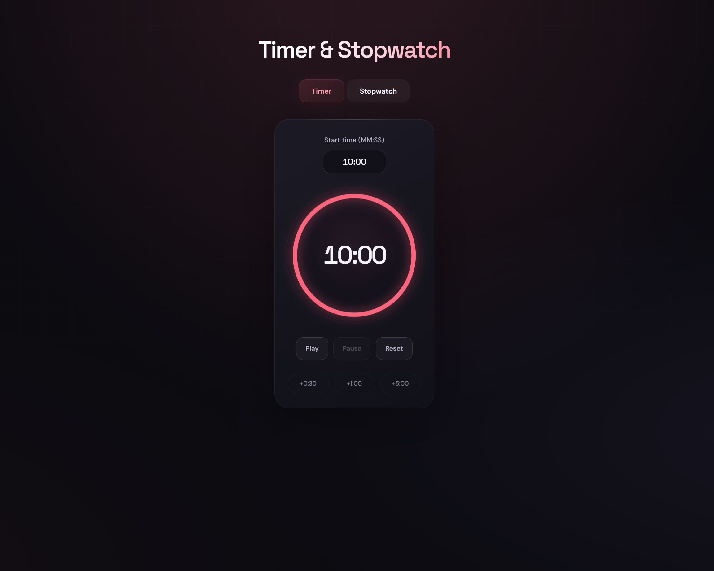
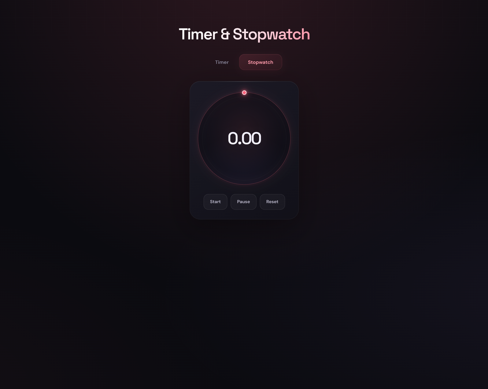

# Timer & Stopwatch

**Time is ticking. At least now it looks good.**

A minimal, dark-themed Timer & Stopwatch built with React, TypeScript, and Vite. Featuring a glowing hot-red aesthetic, circular progress indicators, smooth interactions, and a distraction-free interface.

<p align="center">
  <a href="https://timer-stopwatch-gamma.vercel.app/">
    <strong>Live Demo ↗</strong>
  </a>
  &nbsp; · &nbsp;
  <a href="https://github.com/Ashishjha013/timer-stopwatch">
    <strong>Source Code</strong>
  </a>
</p>

<p align="center">
  
  
  
  
</p>

---

## Preview

<p align="center">
  
  &nbsp;
  
</p>

<p align="center">
  <sub>Two tools. One focused interface.</sub>
</p>

## Features

### ⏱️ Timer

- **Custom duration** — Set your preferred countdown time.
- **Quick adjustments** — Add 30 seconds, 1 minute, or 5 minutes.
- **Playback controls** — Start, pause, and reset the timer.
- **Circular progress** — Track the remaining time visually.
- **Audible alarm** — Get notified when the countdown reaches zero.
- **Live browser title** — See the remaining time directly in your browser tab.

### ⚡ Stopwatch

- **Centisecond precision** — Track elapsed time down to hundredths of a second.
- **Playback controls** — Start, pause, and reset with ease.
- **Animated indicator** — Follow the glowing indicator around the circular ring.

### 🎨 Interface

- Deep-black background with glowing red accents.
- Minimal controls and clean typography.
- Responsive layout for different screen sizes.
- Smooth visual feedback and circular indicators.
- Dedicated Timer and Stopwatch views.

## Tech Stack

| Technology    | Purpose                                     |
| ------------- | ------------------------------------------- |
| React 19      | Component-based user interface              |
| TypeScript    | Type safety and maintainable code           |
| Vite          | Development server and production builds    |
| CSS           | Styling, animations, and responsive layouts |
| Web Audio API | Timer alarm                                 |
| pnpm          | Package management                          |
| Vercel        | Deployment and hosting                      |

## Getting Started

### Prerequisites

Make sure you have the following installed:

- [Node.js](https://nodejs.org/)
- [pnpm](https://pnpm.io/)
- [Git](https://git-scm.com/)

### Installation

**1. Clone the repository**

```bash
git clone https://github.com/Ashishjha013/timer-stopwatch.git
```

**2. Navigate to the project directory**

```bash
cd timer-stopwatch
```

**3. Install dependencies**

```bash
pnpm install
```

**4. Start the development server**

```bash
pnpm dev
```

Open the local URL displayed in your terminal.

### Production Build

Build the application for production:

```bash
pnpm build
```

Preview the production build locally:

```bash
pnpm preview
```

## Project Structure

```text
timer-stopwatch/
├── public/
├── src/
│   ├── assets/
│   │   ├── stopwatch.png
│   │   └── timer.png
│   ├── components/
│   │   ├── Header.tsx
│   │   ├── StopwatchPanel.tsx
│   │   ├── TabButton.tsx
│   │   ├── Tabs.tsx
│   │   └── TimerPanel.tsx
│   ├── App.css
│   ├── App.tsx
│   ├── index.css
│   └── main.tsx
├── .gitignore
├── eslint.config.js
├── index.html
├── package.json
├── pnpm-lock.yaml
├── README.md
├── tsconfig.app.json
├── tsconfig.json
├── tsconfig.node.json
└── vite.config.ts
```

## What I Learned

Building this project helped me put React fundamentals into practice:

- Managing component state with React Hooks.
- Using `useEffect` for timer intervals and effect cleanup.
- Passing data and event handlers through component props.
- Separating application logic from UI presentation.
- Using TypeScript with React components.
- Building circular indicators with CSS and SVG.
- Working with browser audio through the Web Audio API.
- Creating a responsive interface with custom CSS.
- Using Git, GitHub, and Vercel to publish a project.

## Deployment

The application is deployed on **Vercel** and connected to its GitHub repository.

**Live application:** [timer-stopwatch-gamma.vercel.app](https://timer-stopwatch-gamma.vercel.app/)

Changes pushed to the configured production branch trigger a new deployment automatically.

## Author

**Ashish Jha**

Aspiring backend engineer learning through hands-on projects, experimentation, and continuous improvement.

- [GitHub Profile](https://github.com/Ashishjha013)
- [Project Repository](https://github.com/Ashishjha013/timer-stopwatch)
- [Live Demo](https://timer-stopwatch-gamma.vercel.app/)

---

<p align="center">
  <sub>Built with React, TypeScript, and attention to detail. ❤️‍🔥</sub>
</p>
